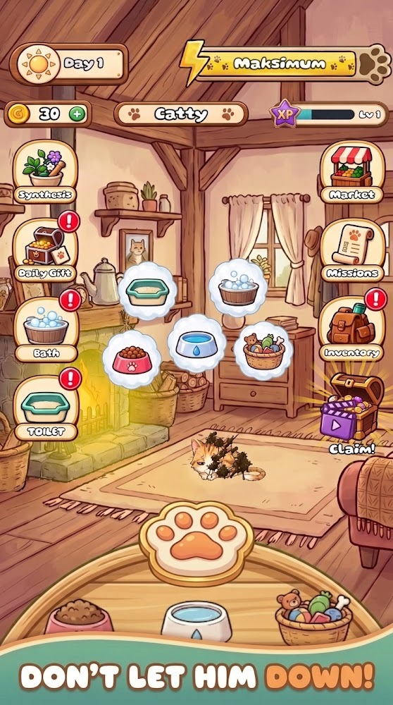
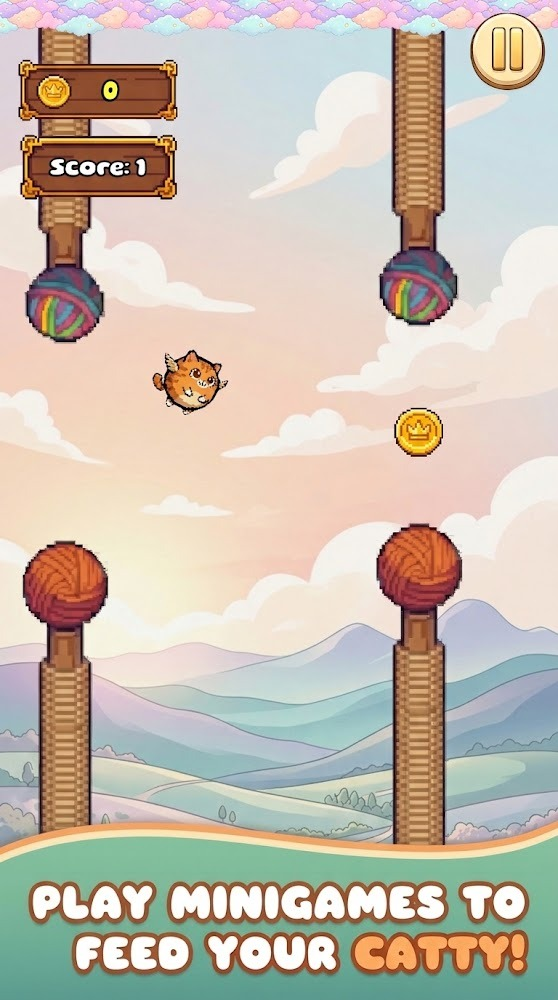
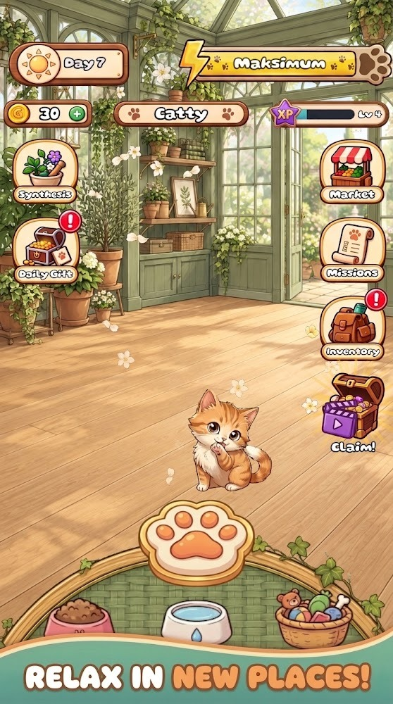
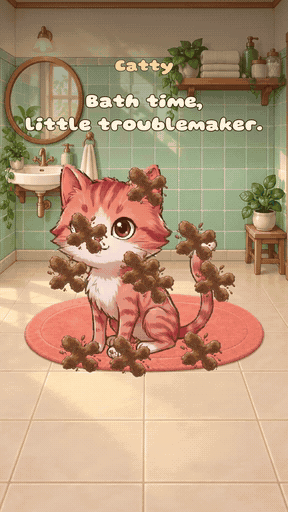
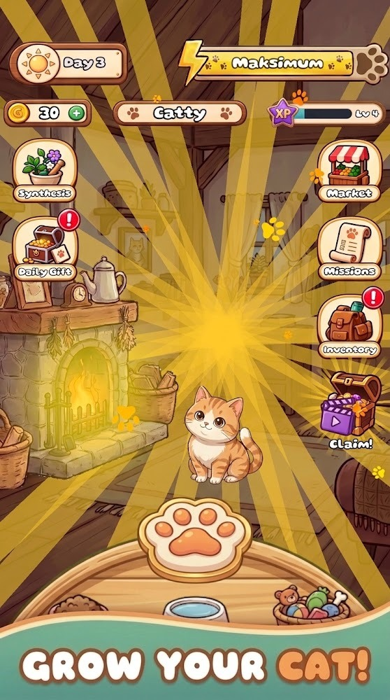
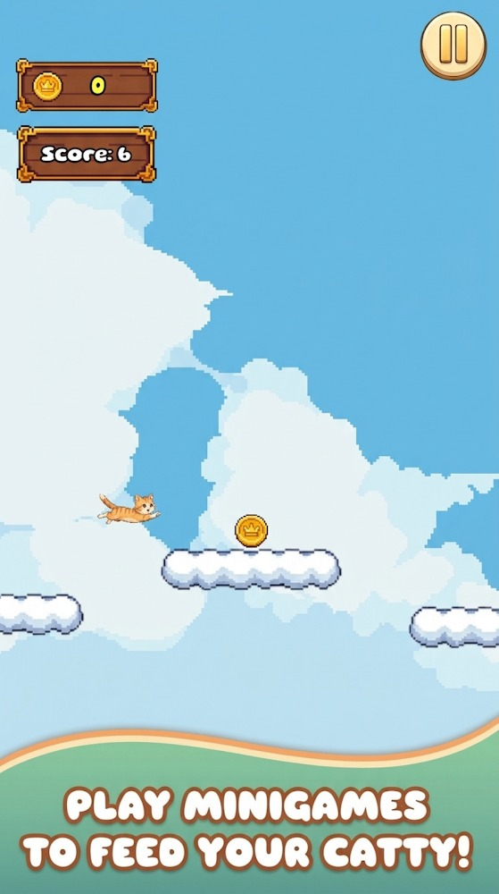
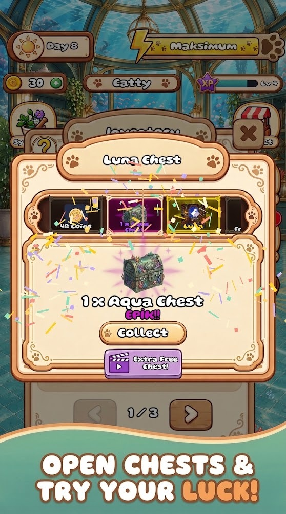
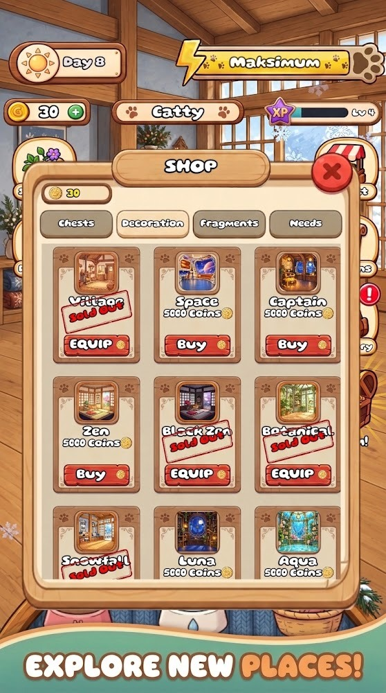

[English](README.md) · [Türkçe](README.tr.md)

# Catty: Virtual Cat&Mini Games

**A virtual pet game for Android, built with Unity and C#.**

Care for a cat, play short arcade mini-games, and use what you earn to look after your pet and unlock new rooms.

[**Play on Google Play**](https://play.google.com/store/apps/details?id=com.thehookgames.catty) · [**Watch the gameplay demo**](#gameplay-demo) · [**Read the engineering case study**](docs/engineering.md)

  

## My role

I'm **Eren Toksöz**, the Unity developer behind Catty. My work spans C# gameplay, mobile UI and touch interaction, progression and save flows, onboarding, and the Android release. The game is published on Google Play under **theHookGames**.

## Gameplay demo

<table>
<tr>
<td width="42%" align="center"></td>
<td valign="top">

**Bath Time · 20-second edited gameplay capture**

The player soaps, rinses, and dries Catty in sequence. Touch input changes the visible dirt, foam, and water, while progress feedback tells the player when to switch tools.

The bath is one part of the loop. Players feed and care for Catty in the home hub, play arcade sessions to earn resources, and spend rewards on care or room customization.

</td>
</tr>
</table>

## Engineering highlights

| Area | What I built |
| --- | --- |
| Touch gameplay | A staged bath interaction that tracks cleaning coverage separately from its visual feedback. Each stage accepts its matching tool, and a completed session can grant its reward once. |
| Arcade sessions | Separate scenes for tap-to-fly, platforming, item collection, and Paw Tap. Scrolling obstacles and platforms use object pools to reuse spawned objects. |
| Progression | Mini-game results feed shared coin and XP progression. Local saves preserve pet state, supplies, and onboarding progress between sessions. |
| Onboarding and mobile UI | Configurable tutorial steps wait for gameplay events before advancing. Contextual highlights and dialogue guide the player through the relevant controls, with layout checks on phone and tablet aspect ratios. |

[**Read the engineering case study**](docs/engineering.md) for the decisions behind the bath interaction, reward flow, and tutorial.

## More from the game

Store screenshots are from the [Google Play listing](https://play.google.com/store/apps/details?id=com.thehookgames.catty). This portfolio repository contains gameplay media and a technical case study. The Unity project is private.

**Eren Toksöz** · [GitHub profile](https://github.com/ErenTzz)
