

[English](README.md) · [Türkçe](README.tr.md)

# Catty: Virtual Cat&Mini Games

**Unity ve C# ile geliştirdiğim Android sanal evcil hayvan oyunu.**

Kedinin bakımını yap, kısa arcade oyunları oyna ve kazandığın kaynaklarla kedinin ihtiyaçlarını karşıla veya yeni odalar aç.

[**Google Play'de oyna**](https://play.google.com/store/apps/details?id=com.thehookgames.catty) · [**Oynanış videoları**](#oynanış-demosu) · [**Teknik inceleme**](docs/engineering.tr.md)

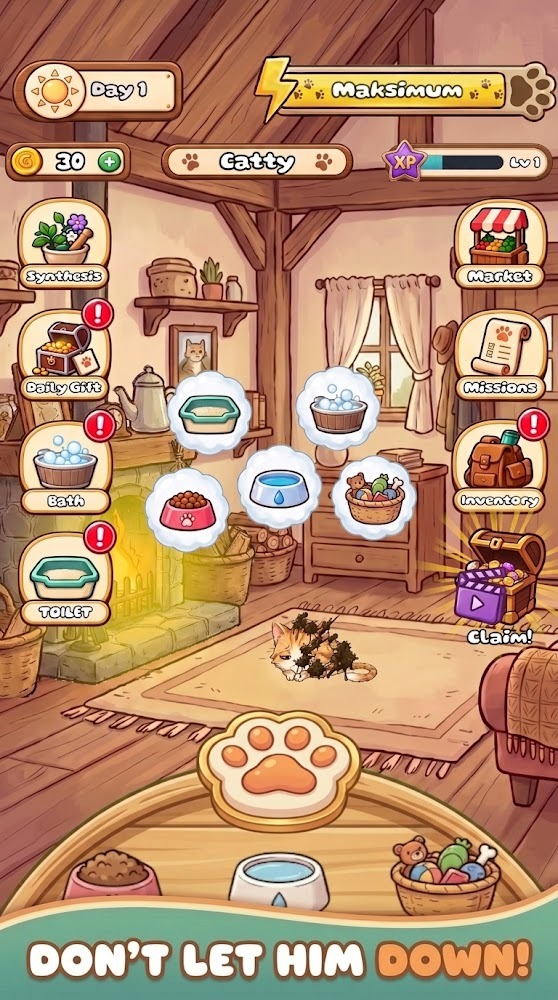 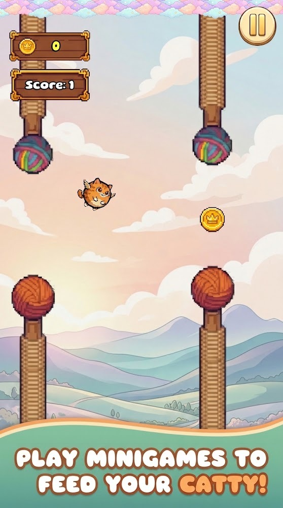 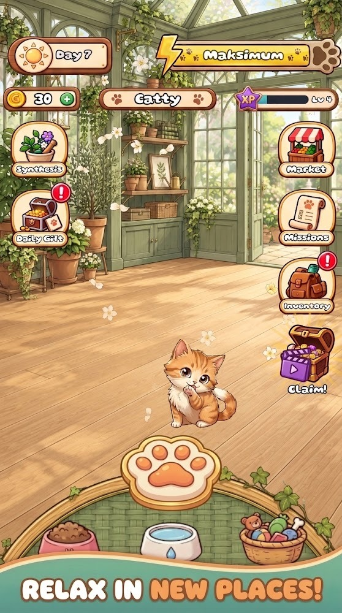

## Rolüm

Ben **Eren Toksöz**, Catty'nin Unity geliştiricisiyim. C# ile oynanış, mobil arayüz ve dokunmatik etkileşim, ilerleme ve kayıt akışları, öğretici ve Android yayını üzerinde çalıştım. Oyun Google Play'de **theHookGames** adıyla yayımlanıyor.

## Oynanış demosu

<table>
<tr>
<th align="center" width="25%">Banyo</th>
<th align="center" width="25%">Paw Tap</th>
<th align="center" width="25%">Dokunarak Uçuş</th>
<th align="center" width="25%">Eşya Toplama</th>
</tr>
<tr>
<td align="center" valign="top">
<a href="https://raw.githubusercontent.com/ErenTzz/catty-showcase/main/media/bath-gameplay.mp4">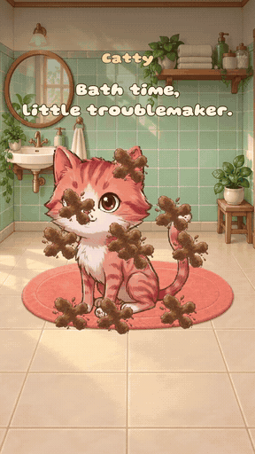</a> 
Catty’yi sabunla, durula ve kurula. 
<a href="https://raw.githubusercontent.com/ErenTzz/catty-showcase/main/media/bath-gameplay.mp4"><strong>Videoyu izle (MP4)</strong></a>
</td>
<td align="center" valign="top">
<a href="https://raw.githubusercontent.com/ErenTzz/catty-showcase/main/media/paw-tap.mp4">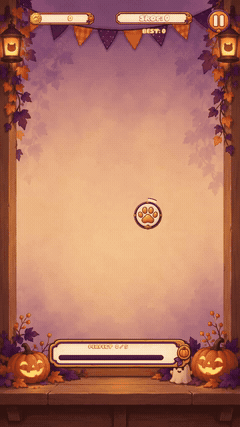</a> 
Kombo yapmak için hedeflere zamanında dokun. 
<a href="https://raw.githubusercontent.com/ErenTzz/catty-showcase/main/media/paw-tap.mp4"><strong>Videoyu izle (MP4)</strong></a>
</td>
<td align="center" valign="top">
<a href="https://raw.githubusercontent.com/ErenTzz/catty-showcase/main/media/tap-to-fly.mp4">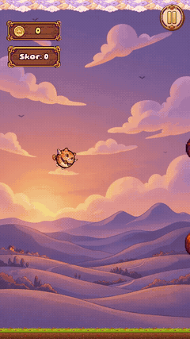</a> 
Yün engellerin arasından uçarak geç. 
<a href="https://raw.githubusercontent.com/ErenTzz/catty-showcase/main/media/tap-to-fly.mp4"><strong>Videoyu izle (MP4)</strong></a>
</td>
<td align="center" valign="top">
<a href="https://raw.githubusercontent.com/ErenTzz/catty-showcase/main/media/item-collection.mp4">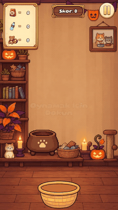</a> 
Düşen bakım malzemelerini sepetle yakala. 
<a href="https://raw.githubusercontent.com/ErenTzz/catty-showcase/main/media/item-collection.mp4"><strong>Videoyu izle (MP4)</strong></a>
</td>
</tr>
</table>

Mini oyun klipleri Unity’de otomatik girdilerle kaydedildi. Tüm MP4 videolar sessizdir.

## Teknik özellikler

| Alan | Geliştirdiğim sistem |
| --- | --- |
| Dokunmatik oynanış | Temizlenen alanı görsel efektlerden bağımsız ölçen üç aşamalı banyo sistemi. Tamamlama ödülü oturum başına bir kez alınabiliyor. |
| Arcade mekanikleri | Ayrı kontrol ve skor kurallarına sahip dört mini oyun. Kayan engeller, platformlar ve Paw Tap hedefleri nesne havuzlarından yeniden kullanılıyor. |
| Kalıcı evcil hayvan simülasyonu | Oyun arka plana geçtiğinde kedinin ihtiyaçları kaydediliyor, oyuncu döndüğünde geçen süre hesaba katılıyor. Sabun ve kumun kalan kullanım hakları mağaza, envanter ve bakım etkinlikleri arasında ortak tutuluyor. |
| İlerleme ve oyun ekonomisi | Mini oyunlardan gelen altın ve deneyim puanı ortak ilerleme sistemine aktarılıyor. Görevler, günlük ödüller ve odaya özel sandıklar eşya kazanmak ve odaları özelleştirmek için farklı yollar sunuyor. |
| Öğretici ve uyarlanabilir arayüz | Yapılandırılabilir adımlar oyun içi olaylarla ilerliyor. Diyalog yerleşimi, vurgulanan kontrolün konumunu ve boyutunu kullanarak telefon ve tablette erişilebilir kalmasını sağlıyor. |
| Yerelleştirme | Unity Localization ile İngilizce, Türkçe, Almanca, İspanyolca ve Fransızca desteği. Editör araçları mevcut arayüz metinlerini çeviri tablolarına taşıyor. Play Mode kontrolleri sabit etiketleri ve oyun sırasında üretilen metinleri kapsıyor. |
| Mobil yaşam döngüsü ve ödüllü reklamlar | Bağlantı durumu değiştiğinde mini oyun seçim akışı güncelleniyor. Ödüllü reklam akışı oyunu duraklatıp devam ettiriyor ve onaylanan ödülü reklamın kapatılması veya hata durumundan ayrı işliyor. |
| Mevsimsel içerik ve paket boyutu | Unity derleme adımı etkin temanın görsellerini sahne, prefab ve animasyon referanslarına işliyor. Kullanılmayan sprite atlasları paket dışında bırakılıyor ve düzenlenebilir varlıklar derleme sonrasında geri yükleniyor. |
| Doğrulama ve sürüm hazırlığı | Unity Editör kontrolleri öğreticiyi, yerelleştirmeyi ve sandık davranışlarını kapsıyor. Git kontrolü, üretilen dosyaların ve yerel araç çıktılarının commit’e eklenmesini engelliyor. |

Bu sistemlerin arkasındaki tasarım kararları [teknik incelemede](docs/engineering.tr.md) yer alıyor.

## Oyundan diğer görseller

<a href="media/progression.jpg">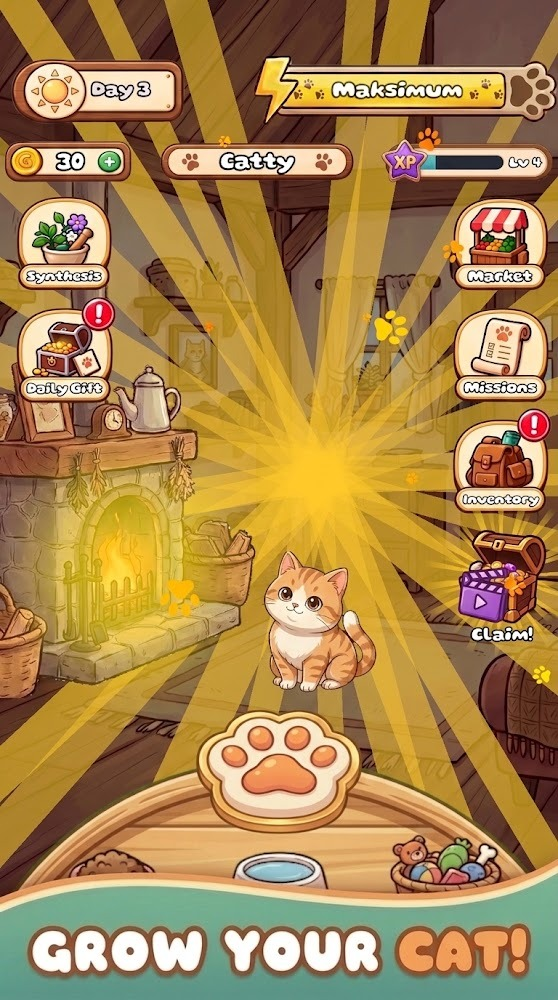</a>
<a href="media/platforming.jpg">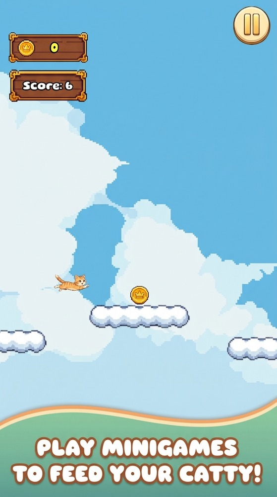</a>
<a href="media/chests.jpg">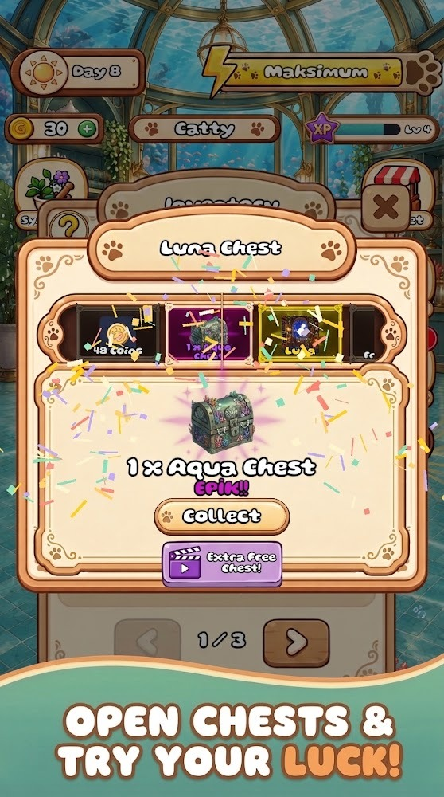</a>
<a href="media/shop.jpg">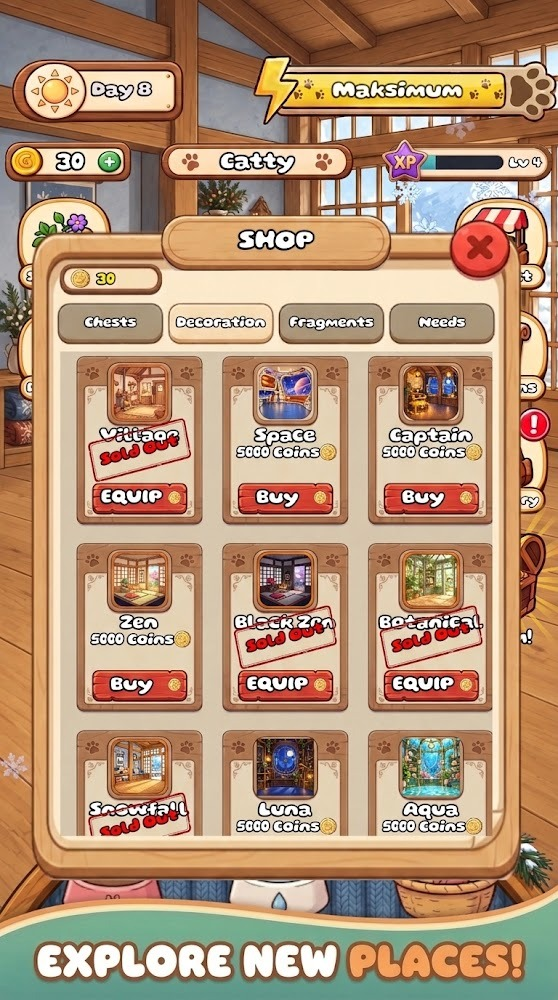</a>

Mağaza görselleri [Google Play sayfasından](https://play.google.com/store/apps/details?id=com.thehookgames.catty) alınmıştır. Bu portfolyo deposu oynanış medyası ve teknik inceleme içerir. Unity projesi özel depoda tutulur.

**Eren Toksöz** · [GitHub profili](https://github.com/ErenTzz)
