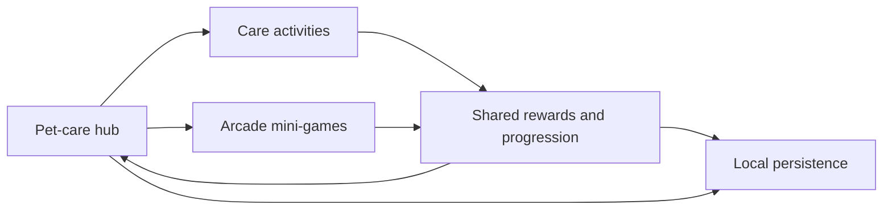

[← Showcase](../README.md) · [Türkçe](engineering.tr.md)

# Catty engineering case study

Catty combines a persistent pet-care hub with short arcade sessions. The central design question was how to let each activity have its own controls and rules while keeping rewards and pet progression coherent across scenes.

## Turning touch input into bath progress

Bath Time gives the player three tools in sequence. Each touch stroke contributes coverage to a region of the cat. The session checks whether the tool matches the current stage and whether the input applies to an active region. Coverage drives stage completion. The presentation layer shows dirt, foam, water, and progress as the session changes.

Separating coverage from presentation lets the visuals change while the completion rules stay consistent. The reward can be claimed only after the final stage, and the session tracks whether it has already been claimed. [See the interaction in motion.](../media/bath-gameplay.gif)

## Bringing mini-game rewards back to the hub

Each mini-game owns its playfield, input, and scoring. Session coins and pending XP are tracked during play and applied to shared progression through the result flow. The hub can use the resulting balances without knowing how a given mini-game scored the run. Mobile lifecycle handling also matters here because a player can pause the app or leave a scene while a session is in progress.

The tap-to-fly and platforming scenes recycle obstacle pairs and platforms using object pools. The pools can grow when the active playfield needs more objects. The reward flow and spawning logic serve different parts of the game and can be adjusted independently.

## Teaching actions in context

The tutorial represents onboarding as configurable steps. A step can show dialogue, highlight a control, or wait for a gameplay event. Event-driven completion keeps the instruction visible until the player performs the relevant action. Local progress records which parts of onboarding the player has completed.

Dialogue placement uses the highlighted control's screen bounds. This addressed a concrete tablet issue where the instruction card could cover a food recipe the player was being asked to select. The layout was checked on phone and tablet views after the change.

## Preserving pet state across sessions

The care loop needs to stay consistent when the player switches apps. Catty saves the pet's needs on backgrounding and uses elapsed time when restoring the state. The shop, inventory, and care activities read the same remaining-use counters for consumables such as soap and litter. This lets the shop grant a pack while a care activity consumes an individual use.

Room chests make room customization part of progression. Chest definitions describe the rewards for each room, and the opening animation presents the selected reward. Editor checks cover room rewards and reward selection behavior.

## Localizing existing Unity UI

Catty supports English, Turkish, German, Spanish, and French. The project uses string tables for UI labels and localized templates for text assembled during play, such as mission reward labels. Migration tooling previews changes to scenes and prefabs so existing bindings and translations can be reviewed before applying updates. Validation covers locale lookup, prefab inheritance, and switching languages while the game is running.

## Handling connectivity changes and rewarded ads

A connectivity monitor updates the mini-game selection UI when the connection drops or returns. Rewarded ads have a separate flow for pausing gameplay, handling the outcome, and resuming play. The flow distinguishes a confirmed reward from a close or a load or display failure. This matters for optional actions such as refilling energy or multiplying the rewards from a mini-game.

## Packaging seasonal content for Android

The active seasonal theme supplies artwork for several scenes, prefabs, and animations. Resolving every replacement at runtime would keep fallback artwork in the build dependency graph. For a theme selected at startup, the build step resolves references ahead of time, retains the entries still needed for runtime lookups, and excludes sprite atlases that the build no longer uses. The tool backs up editable assets before making changes and restores them after the build or during recovery.
