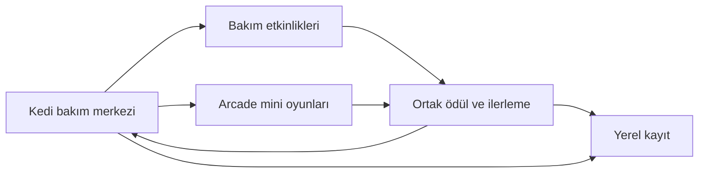

[← Vitrine dön](../README.tr.md) · [English](engineering.md)

# Catty teknik incelemesi

Catty, oturumlar arasında durumunu koruyan bir bakım merkeziyle kısa arcade oyunlarını bir araya getiriyor. Temel tasarım sorusu, her etkinliğin kendi kontrol ve kurallarına sahip olmasını sağlarken ödül ve kedi ilerlemesini sahneler arasında nasıl ortak tutacağımdı.

## Dokunuşları banyo ilerlemesine dönüştürmek

Banyo etkinliğinde oyuncu sırayla üç araç kullanıyor. Her dokunmatik hareket, kedinin bir bölgesinde yapılan işlemin kapsama oranını artırıyor. Oturum, kullanılan aracın o aşamaya ait olup olmadığını ve hareketin aktif bir bölgede gerçekleşip gerçekleşmediğini kontrol ediyor. Kapsama oranı aşamanın ne zaman tamamlandığını belirliyor. Görsel katman oturum değiştikçe kir, köpük, su ve ilerlemeyi ekrana yansıtıyor.

Kapsama hesabını görsel sunumdan ayırmak, tamamlama kurallarını koruyarak efektleri değiştirmeyi mümkün kılıyor. Ödül son aşama bittikten sonra alınabiliyor ve oturum ödülün daha önce alınıp alınmadığını takip ediyor. [Banyo demosunu izle.](../media/bath-gameplay.gif)

## Mini oyun ödüllerini bakım merkezine taşımak

Her mini oyun kendi oyun alanını, girişlerini ve skorunu yönetiyor. Oyun sırasında biriken altın ve deneyim puanı takip ediliyor ve sonuç akışında ortak ilerlemeye aktarılıyor. Bakım merkezi, her mini oyunun skoru nasıl hesapladığını bilmeden bu bakiyeleri kullanabiliyor. Mobilde oyuncu oturum devam ederken uygulamayı arka plana alabileceği veya sahneden çıkabileceği için bu geçişler de kayıt akışının parçası.

Dokunarak uçma ve platform sahneleri, engel çiftlerini ve platformları nesne havuzlarıyla yeniden kullanıyor. Aktif oyun alanı daha fazla nesneye ihtiyaç duyduğunda havuzlar büyüyebiliyor. Ödül akışı ve nesne üretimi birbirinden bağımsız olarak ayarlanabiliyor.

## Eylemleri oyun içinde öğretmek

Öğretici, yapılandırılabilir adımlardan oluşuyor. Bir adım diyalog gösterebiliyor, bir kontrolü vurgulayabiliyor veya oyun içi bir olayı bekleyebiliyor. Oyuncu ilgili eylemi yapana kadar yönlendirme görünür kalıyor. Tamamlanan adımlar yerel olarak kaydediliyor.

Diyalog yerleşimi, vurgulanan kontrolün ekrandaki konumunu ve boyutunu kullanıyor. Bu değişiklik, tablette diyalog kartının oyuncudan seçmesi istenen mama tarifini kapattığı bir durumu giderdi. Yerleşim değişiklikten sonra telefon ve tablet görünümlerinde kontrol edildi.
